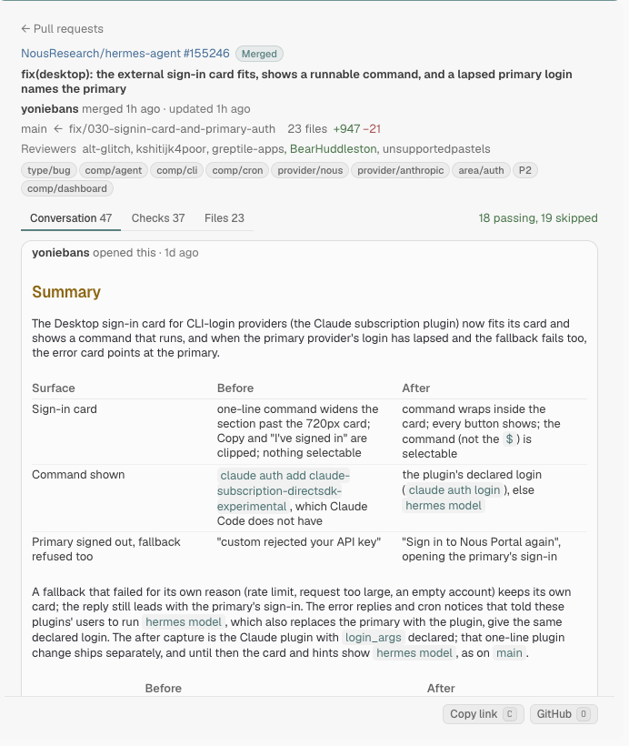
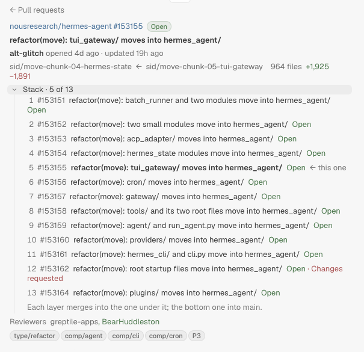
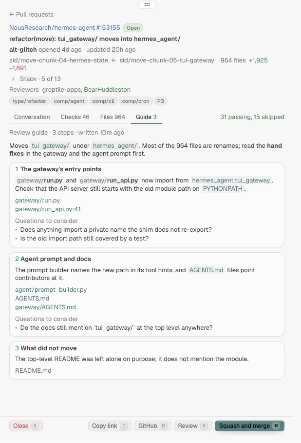
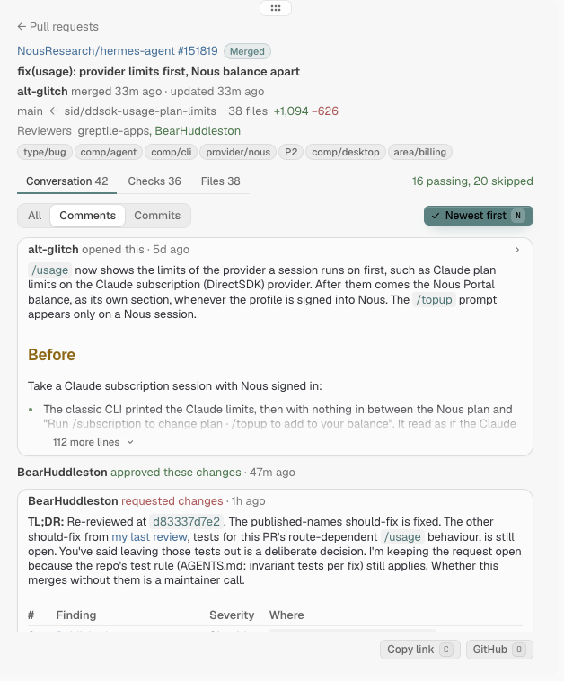
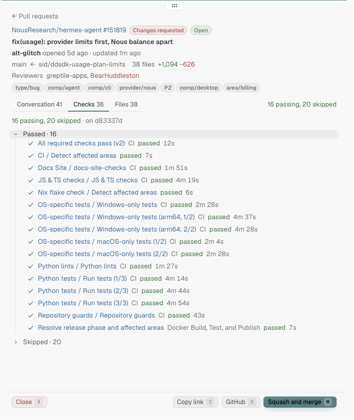
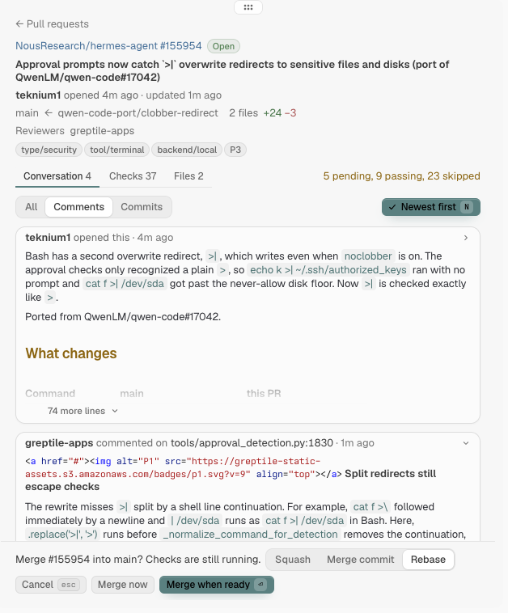
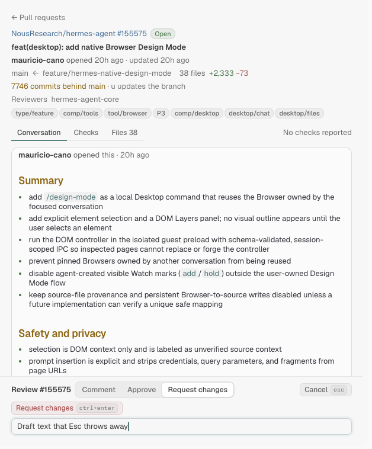
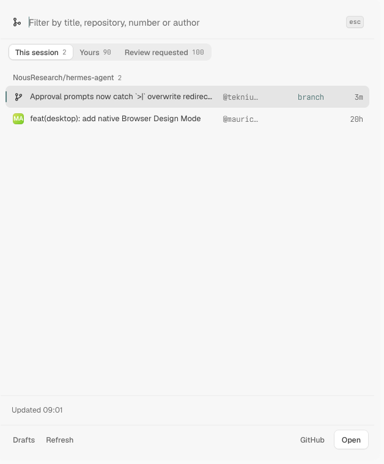
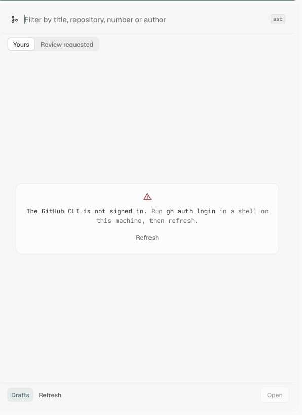

# prs

A Tern block for pull requests: lists to find one, and a page to read and act on it without
leaving the terminal. Everything comes from the GitHub CLI.



## Open it

- **Pull requests** in the command palette (⌘K), or ⌥⇧⌘P.
- From a program, `tern open <file>.prs.json` (see [List files](#list-files)).

The block opens to the right of the focused pane. Outside a Hermes pane, if a block is already
open in the window, Tern focuses it instead, because each open block polls GitHub.

## The lists

**Yours** holds your open pull requests and **Review requested** the open ones waiting on your
review. Both are grouped by repository, the most recently updated first, and refresh every two
minutes. A list file adds a tab of its own in front, such as **This session**.


Type to filter the current list by title, repository, number or author; the matched part of the
title shows in bold. Filtering Review requested by title finds
[NousResearch/hermes-agent#155575](https://github.com/NousResearch/hermes-agent/pull/155575):


Enter opens the selected pull request's page.

## A pull request's page

The header shows the repository and number, the review decision and state, the title, who opened
it and when, the base and head branches, its size, whether it conflicts with its base or how far
behind it is, its reviewers (green approved, red changes requested, dim not yet answered) and its
labels. The title and author show at once from the list row while GitHub answers.

A pull request in a GitHub stack (pull requests that each merge into the one under it, as `gh stack`
makes them) gets a folded **Stack · 5 of 13** line. Opened, it lists every layer from the bottom
with its number, title, state and review decision, and marks this one. Clicking a layer opens its
page in place.



Three tabs follow:

- **Conversation:** the description, then every comment, review, review thread and commit in
  order. Markdown renders as Tern draws it, Mermaid diagrams and tables included. A long
  description shows its first 12 lines and a "more lines" button that opens the rest. Resolved and
  outdated threads start folded, and runs of commits fold into one line. Comments and reviews by
  bots (GitHub Apps such as CI and review bots) start hidden behind a line that counts them; their
  review threads on code lines stay. **All**, **Comments** and **Commits** at the top choose what
  shows, and **Newest first** (`n`) turns the order around. The block remembers both.
- **Checks:** the checks of the latest commit in four groups: needs attention and running open,
  passed and skipped folded, each with its workflow, its result and how long it took.
- **Files:** each changed file as Tern's edit card with its diff. Deleted files and diffs over
  400 lines start folded.
- **Guide** (with its number of stops), only when the list file holds a review guide for this pull
  request (see [List files](#list-files)).

### Guide

A review guide is a tour of the pull request that a Hermes chat wrote: a summary, then numbered
stops, each with notes, the files it is about and questions to consider. A file the pull request
changes is a link: clicking it opens the Files tab scrolled to that file's card. A path the pull
request does not change, or one past the first 100 files the Files tab reads, stays plain text. When
the guide names a head commit and the branch has moved on since, a line above the summary says so:
"This guide was written for 7c1f0e2; the branch is now at 1c52ab3." The block re-reads the list
file every three seconds, so a new or changed guide shows without reopening the page.








The buttons under the page act on the pull request: **Close**, **Reopen**, **Ready for
review**, **Update branch**, **Re-run failed**, **Review**, **Approve** and the repository's
preferred merge (**Squash and merge**, say). Each shows only when it applies and GitHub lets you do
it; Approve shows on other people's open pull requests. Merge, close and approve ask first. **Copy
link** and **GitHub** work on any pull request.

### Merging

The merge button uses the method you merged with last in this block, or else the repository's
preferred one. The question before a merge shows the methods the repository allows (**Squash**,
**Merge commit**, **Rebase**); click one or press Tab to switch. When checks are still running and
nothing else blocks the merge, the button reads **Merge when ready** and turns on GitHub's
auto-merge (`gh pr merge --auto`); **Merge now** next to it merges at once. A pull request with
auto-merge on shows **Auto-merge on (squash)** in its header and a **Turn off auto-merge** button,
which asks first.



### Reviews

**Review** (`v`) opens a form under the page: a text field and a choice of **Comment**,
**Approve** or **Request changes**. Tab switches the choice. Comment and Request changes need some
text; Approve may go without. ctrl+Enter or the button sends it, and the page reads GitHub again.
Esc closes the form and drops the text. On your own pull request, and on a draft, only Comment
shows, because GitHub refuses the other two there. While the form is open, every key goes to the
text field, so typing `m` or `x` does not merge or close.



## Keys

In a list:

| Key | Does |
| --- | --- |
| type | Filters by title, repository, number or author |
| ↑ ↓, Page Up/Down, Home/End | Move |
| Enter, or double-click | Opens the pull request's page |
| ctrl+o | Opens the pull request on GitHub |
| Tab, Shift+Tab | Switches lists |
| Esc, ctrl+u | Clears the filter |
| ctrl+r | Refreshes now |
| ctrl+d | Shows or hides drafts (remembered across restarts) |

On a page:

| Key | Does |
| --- | --- |
| Esc, Backspace, ← | Back to the list |
| `[` `]` | The previous or next pull request in the list |
| Tab, Shift+Tab, `1` `2` `3` | Conversation, Checks, Files |
| `4` | Guide, when the pull request has one (Tab and Shift+Tab include it) |
| ↑ ↓ (or `k` `j`), Space, Page Up/Down, Home/End | Scroll |
| `o` / `c` | Open on GitHub / copy its link |
| `m` / `x` / `a` | Merge / close / approve, after a question (Enter or `y` confirms, Esc or `n` cancels; Tab switches the merge method) |
| `v` | Opens the review form |
| `b` | Shows or hides comments by bots |
| `n` | Conversation newest first, or oldest first (remembered) |
| `d` / `u` / `f` | Ready for review / update branch / re-run failed jobs |
| `r`, ctrl+r | Reads it again |

In the review form:

| Key | Does |
| --- | --- |
| type, Enter | Writes the review; Enter starts a new line |
| Tab, Shift+Tab | Comment, Approve, Request changes |
| ctrl+Enter | Sends the review |
| Esc | Closes the form and drops the text |

## List files

A list file names pull requests some program picked; opening one shows them in a tab of its own,
in front of the others. The block re-reads the file every three seconds, so the tab follows the
program, and a new `selected` (or a new `opened_at` with the same one) opens that pull request's page.

```json
{
  "version": 1,
  "title": "This session",
  "prs": [
    { "url": "https://github.com/NousResearch/hermes-agent/pull/155575" },
    { "repository": "NousResearch/hermes-agent", "number": 151819 }
  ],
  "selected": "NousResearch/hermes-agent#151819"
}
```

| Field | Meaning |
| --- | --- |
| `version` | `1`. A file with another version is ignored |
| `title` | The tab's label; default `This session` |
| `prs` | Each a GitHub pull request URL, or `repository` and `number` |
| `selected` | Optional `owner/repo#number`, any case: opens that pull request's page |
| `opened_at` | Optional number, such as the time of the pick: a new value opens `selected` again |
| `cwd` | Optional absolute path of a git checkout: adds the pull request of its current branch |
| `tab` | Optional, with `selected`: the tab its page opens on, `conversation`, `checks`, `files` or `guide`. Anything else, or `guide` for a pull request without a guide, opens Conversation. A page opened from a click ignores it |
| `guides` | Optional review guides, keyed by `owner/repo#number` in lower case (the form of `selected`). Each is `head_sha` (optional, the head commit the guide was written for), `written_at` (Unix seconds), `summary` (Markdown) and `stops`: 1 to 20 of `title`, `notes` (Markdown), `files` (up to 20 repository paths, each optionally ending in `:<line>`) and `questions` (up to 5, plain text). Wrong types are skipped |

A guide entry looks like this:

```json
"tab": "guide",
"guides": {
  "nousresearch/hermes-agent#153155": {
    "head_sha": "1c52ab31cdbff74637aed58a9ebd65b480175564",
    "written_at": 1763189990,
    "summary": "Moves `tui_gateway/` under `hermes_agent/`; read the hand fixes first.",
    "stops": [
      {
        "title": "The gateway's entry points",
        "notes": "`gateway/run_api.py` now imports from `hermes_agent.tui_gateway`.",
        "files": ["gateway/run.py", "gateway/run_api.py:41"],
        "questions": ["Does anything import a private name the shim does not re-export?"]
      }
    ]
  }
}
```

[hermes-tern](https://github.com/alt-glitch/hermes-tern) writes `guides` and `tab`; the block only
reads them.

With `cwd`, the block runs `gh pr view` in that directory. When the checkout's branch has a pull
request that `prs` does not name, it joins the tab with a branch icon and the word `branch` in place
of its state. It is read again on every refresh, so switching branches changes it.



The file name must end in `.prs.json`. Run `tern open <file>` from a pane to open it to the right of
that pane. Opening the same file again focuses its block instead of adding one. `tern open` then
exits 1 ("cannot open in a file block") although the block shows, because the plugin handled the
open; a program should not read that as a failure.

### Hermes

[hermes-tern](https://github.com/alt-glitch/hermes-tern) keeps a list file per Hermes pane, holding
the pull requests that pane's session linked: `$HERMES_HOME/plugin-data/hermes-tern/panes/<pane>.prs.json`.
Its PR pill opens that file, and ⌘K or ⌥⇧⌘P from a Hermes pane opens it too, to the right of
that pane:


## Needs

The block runs `gh` on the machine that runs your panes, so install the
[GitHub CLI](https://cli.github.com) there and sign in with `gh auth login`. If `gh` is missing or
signed out, the block says so and offers a refresh:



If a later refresh fails, the block keeps the last list and shows the problem above the buttons,
where it otherwise shows when the list was last updated.
