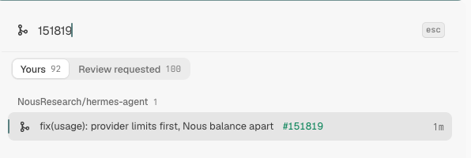
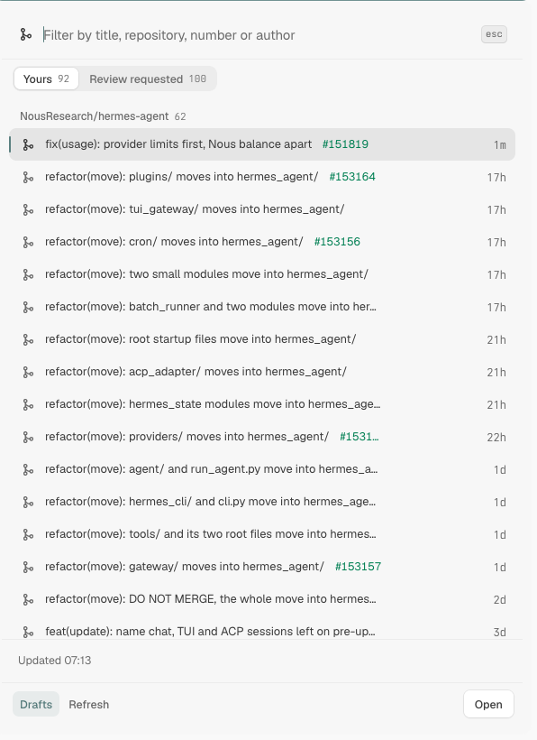

# prs

A Tern block for browsing pull requests. It has two lists: **Yours** (your open pull requests)
and **Review requested** (open pull requests waiting on your review). Each list is grouped by
repository, with the most recently updated repository and pull request first. Both lists come
from the GitHub CLI and refresh every two minutes.

## Open it

- **Pull requests** in the command palette (⌘K), or
- ⌥⇧⌘P.

The block opens to the right of the focused pane. If one is already open in the window, Tern
focuses it instead, because each open block polls GitHub.

## Find a pull request

Type to filter the current list. The filter matches the title, the repository, the number and
the author, and shows the matched part of the title in bold. Enter opens the selected pull
request on GitHub.

Filtering Review requested by title finds
[NousResearch/hermes-agent#155575](https://github.com/NousResearch/hermes-agent/pull/155575):

Filtering Yours by number finds
[NousResearch/hermes-agent#151819](https://github.com/NousResearch/hermes-agent/pull/151819):

Clearing the filter keeps the selection on the same pull request.

Yours leaves out the author column, because every row there is you:

## Keys

| Key | Does |
| --- | --- |
| type | Filters by title, repository, number or author |
| ↑ ↓, Page Up/Down, Home/End | Move |
| Enter, or double-click | Opens the pull request on GitHub |
| Tab, Shift+Tab | Switches between Yours and Review requested |
| Esc, ctrl+u | Clears the filter |
| ctrl+r | Refreshes now |
| ctrl+d | Shows or hides drafts (remembered across restarts) |

## Needs

The block runs `gh search prs` on the machine that runs your panes, so install the
[GitHub CLI](https://cli.github.com) there and sign in with `gh auth login`. If `gh` is missing or
signed out, the block says so and offers a refresh:

If a later refresh fails, the block keeps the last list and shows the problem above the buttons,
where it otherwise shows when the list was last updated.
