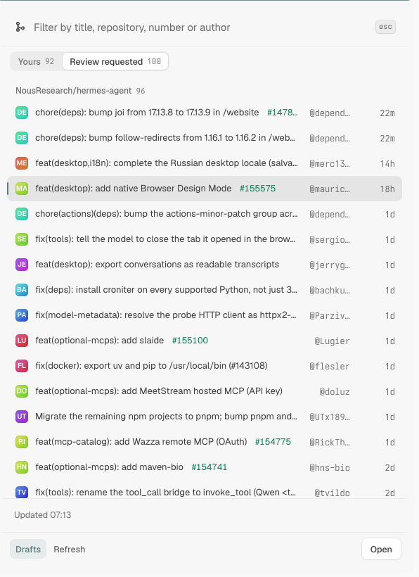
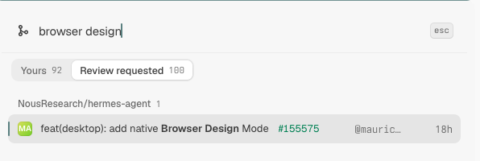
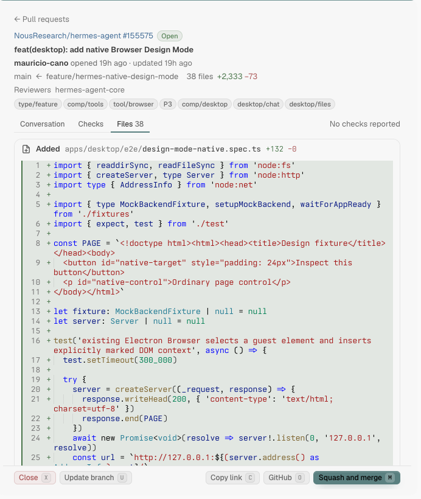
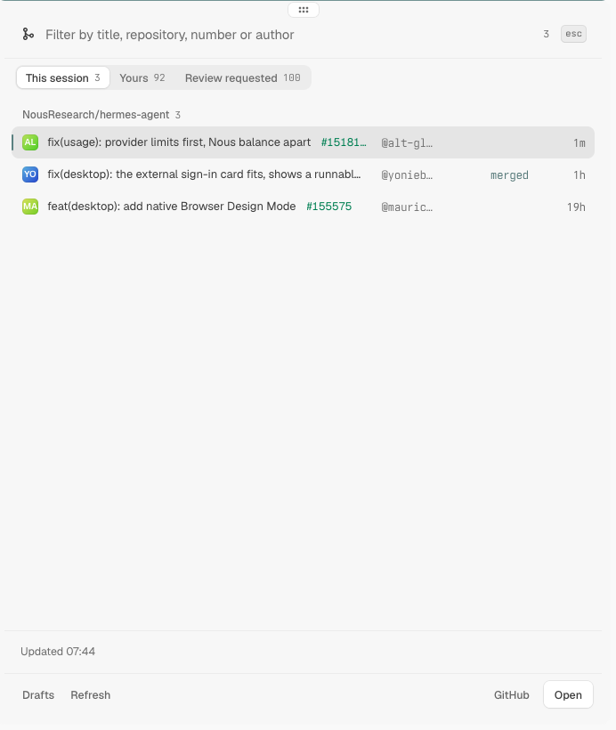

# prs

A Tern block for pull requests: lists to find one, and a page to read and act on it without
leaving the terminal. Everything comes from the GitHub CLI.


## Open it

- **Pull requests** in the command palette (⌘K), or ⌥⇧⌘P.
- From a program, `tern open --split right <file>.prs.json` (see [List files](#list-files)).

The block opens to the right of the focused pane. Outside a Hermes pane, if a block is already
open in the window, Tern focuses it instead, because each open block polls GitHub.

## The lists

**Yours** holds your open pull requests and **Review requested** the open ones waiting on your
review. Both are grouped by repository, the most recently updated first, and refresh every two
minutes. A list file adds a tab of its own in front, such as **This session**.



Type to filter the current list by title, repository, number or author; the matched part of the
title shows in bold. Filtering Review requested by title finds
[NousResearch/hermes-agent#155575](https://github.com/NousResearch/hermes-agent/pull/155575):



Enter opens the selected pull request's page.

## A pull request's page

The header shows the repository and number, the review decision and state, the title, who opened
it and when, the base and head branches, its size, whether it conflicts with its base or how far
behind it is, its reviewers (green approved, red changes requested, dim not yet answered) and its
labels. The title and author show at once from the list row while GitHub answers. Three tabs
follow:

- **Conversation:** the description, then every comment, review, review thread and commit in
  order. Markdown renders as Tern draws it, Mermaid diagrams and tables included. Resolved and
  outdated threads start folded, and runs of commits fold into one line. Comments and reviews by
  bots (GitHub Apps such as CI and review bots) start hidden behind a line that counts them; their
  review threads on code lines stay.
- **Checks:** the checks of the latest commit in four groups: needs attention and running open,
  passed and skipped folded, each with its workflow, its result and how long it took.
- **Files:** each changed file as Tern's edit card with its diff. Deleted files and diffs over
  400 lines start folded.




The buttons under the page act on the pull request: **Close**, **Reopen**, **Ready for
review**, **Update branch**, **Re-run failed**, **Approve** and the repository's preferred merge
(**Squash and merge**, say). Each shows only when it applies and GitHub lets you do it; Approve
shows on other people's open pull requests. Merge, close and approve ask first. **Copy link** and **GitHub** work on any pull request.

## Keys

In a list:

| Key | Does |
| --- | --- |
| type | Filters by title, repository, number or author |
| ↑ ↓, Page Up/Down, Home/End | Move |
| Enter, or double-click | Opens the pull request's page |
| ctrl+o | Opens the pull request on GitHub |
| Tab, Shift+Tab | Switches lists |
| Esc, ctrl+u | Clears the filter |
| ctrl+r | Refreshes now |
| ctrl+d | Shows or hides drafts (remembered across restarts) |

On a page:

| Key | Does |
| --- | --- |
| Esc, Backspace, ← | Back to the list |
| `[` `]` | The previous or next pull request in the list |
| Tab, Shift+Tab, `1` `2` `3` | Conversation, Checks, Files |
| ↑ ↓ (or `k` `j`), Space, Page Up/Down, Home/End | Scroll |
| `o` / `c` | Open on GitHub / copy its link |
| `m` / `x` / `a` | Merge / close / approve, after a question (Enter or `y` confirms, Esc or `n` cancels) |
| `b` | Shows or hides comments by bots |
| `d` / `u` / `f` | Ready for review / update branch / re-run failed jobs |
| `r`, ctrl+r | Reads it again |

## List files

A list file names pull requests some program picked; opening one shows them in a tab of its own,
in front of the others. The block re-reads the file every three seconds, so the tab follows the
program, and a new `selected` opens that pull request's page.

```json
{
  "version": 1,
  "title": "This session",
  "prs": [
    { "url": "https://github.com/NousResearch/hermes-agent/pull/155575" },
    { "repository": "NousResearch/hermes-agent", "number": 151819 }
  ],
  "selected": "NousResearch/hermes-agent#151819"
}
```

| Field | Meaning |
| --- | --- |
| `version` | `1`. A file with another version is ignored |
| `title` | The tab's label; default `This session` |
| `prs` | Each a GitHub pull request URL, or `repository` and `number` |
| `selected` | Optional `owner/repo#number`: opens that pull request's page |

The file name must end in `.prs.json`. Run `tern open --split right <file>` from a pane to open
it beside that pane.

### Hermes

[hermes-tern](https://github.com/alt-glitch/hermes-tern) keeps a list file per Hermes pane, holding
the pull requests that pane's session linked: `$HERMES_HOME/plugin-data/hermes-tern/panes/<pane>.prs.json`.
Its PR pill opens that file, and ⌘K or ⌥⇧⌘P from a Hermes pane opens it too, to the right of
that pane:



## Needs

The block runs `gh` on the machine that runs your panes, so install the
[GitHub CLI](https://cli.github.com) there and sign in with `gh auth login`. If `gh` is missing or
signed out, the block says so and offers a refresh:


If a later refresh fails, the block keeps the last list and shows the problem above the buttons,
where it otherwise shows when the list was last updated.
